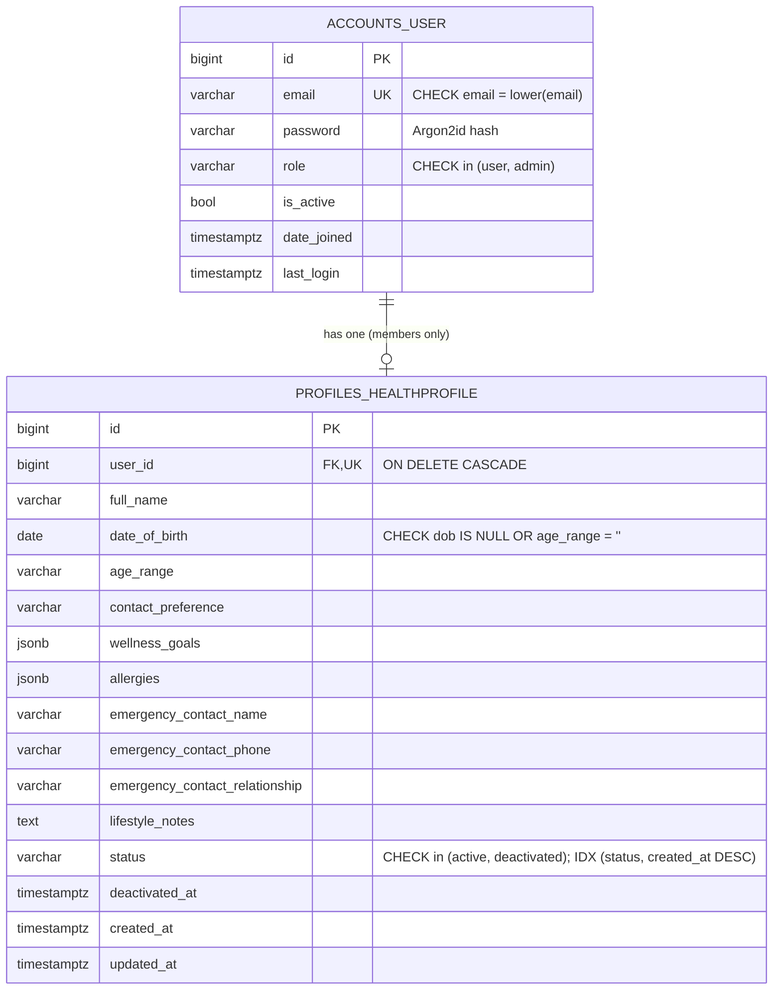

# Architecture and design decisions

## Problem

A small HealthTech product where **members** keep a wellness profile and **administrators** review
profiles. The hard part is not the CRUD; it is that the two roles authenticate in two *different*
ways and must be provably unable to borrow each other's privileges. All data is synthetic and the
app stores wellness preferences, not medical records.

## System overview

```mermaid
flowchart LR
  B[Browser] -- "same origin :3000" --> N[Next.js<br/>pages + /api proxy]
  N -- "/api/* rewrite" --> D[Django + DRF :8000]
  D --> P[(PostgreSQL)]
  subgraph D_internals [Django]
    A1[CookieJWTAuthentication<br/>members] --> V1[/api/profiles/me/]
    A2[AdminSessionAuthentication<br/>admins] --> V2[/api/admin/*]
  end
```

The browser only talks to Next.js. Next forwards `/api/*` to Django, so every cookie is first-party
(no CORS, no `SameSite=None`) and the API is not exposed to arbitrary origins.

## Why this stack

| Choice | Why | Trade-off |
|---|---|---|
| **Django + DRF** | Mature auth primitives (password hashing, sessions, CSRF, migrations, validators). For a security-sensitive assignment I want to *compose audited parts*, not hand-roll them. | Heavier than FastAPI; sync by default. Irrelevant at this scale. |
| **PostgreSQL** | Real constraints (CHECK, partial/composite indexes), `EXPLAIN ANALYZE`, JSONB. SQLite works for a 2-minute local start. | Needs a server; `docker-compose.yml` provided. |
| **SimpleJWT** for members | Standard, maintained JWT implementation with rotation and a blacklist. | JWT is only worth it with the extra care below. |
| **Django sessions** for admins | Server-side revocation, no token the client can hold or forge. Right tool for a small high-privilege group. | Needs a DB/cache lookup per request. |
| **Next.js (App Router, TS)** | Required stack; rewrites give the same-origin proxy for free. | SPA-style client pages (no SSR of private data, on purpose). |
| **drf-spectacular** | OpenAPI/Swagger generated from the code so docs cannot drift. | |
| **Argon2id** | OWASP's preferred password hash. | Slow on purpose; tests swap in a fast hasher. |

## Two auth systems, kept apart on purpose

| | Member | Admin |
|---|---|---|
| Created by | Public `POST /api/auth/signup/` | **Only** `manage.py create_admin` / `seed_demo` |
| Credential after login | JWT access (10 min) + refresh (7 d) in **HttpOnly** cookies | Server-side session id in an **HttpOnly** cookie (30 min idle) |
| DRF authenticator | `CookieJWTAuthentication` | `AdminSessionAuthentication` |
| Permission | `IsStandardUser` (role == user) | `IsAdminRole` (role == admin) |
| Logout | Refresh token blacklisted, cookies cleared | Session row deleted server-side |
| CSRF | Enforced on unsafe methods | Enforced on unsafe methods |

`DEFAULT_AUTHENTICATION_CLASSES` is **empty**. Every view names its authenticator explicitly, so the
two mechanisms cannot be mixed by accident, and a new view with no authenticator fails closed.

### Why a user token can never reach admin routes (defence in depth)

1. Admin views only run `AdminSessionAuthentication`; they never read the JWT cookie.
2. Even a valid session must belong to a user whose `role` column is `admin` (`IsAdminRole`).
3. Admin accounts have no signup path; the signup serializer has no `role` field.
4. Admin login rejects member credentials and vice-versa (same generic 401, so roles do not leak).
5. The frontend holds **no** auth state; admin pages call `/api/admin/me` on every load. Editing
   `localStorage`/cookies in devtools changes nothing server-side. (Tested in the browser run.)

### Token/session hardening

- Cookies: `HttpOnly`, `Secure` (non-debug), `SameSite=Lax`. The refresh cookie is scoped to
  `/api/auth/user/` so it is not sent with ordinary API calls.
- Refresh tokens rotate and are **single use**; replaying an old one fails (tested).
- JWT claims contain only `user_id`, `jti`, `exp`, `iat`, `token_type`: no password, email or role.
- `alg: none`, tampered-payload, refresh-as-access and `Authorization`-header tokens are all rejected (tested).
- Deactivating a profile sets `user.is_active=False`; because the access cookie is re-checked
  against the DB on each request, an already-issued JWT stops working immediately.
- Login/signup are throttled (10/min, 20/h by default). Login errors are identical for unknown
  email, wrong password, deactivated account and wrong role (no account enumeration).
- Login is CSRF-protected too (prevents login-CSRF); `csrf_protect` is re-applied because DRF
  views are `csrf_exempt` by default.

## Database



Also present (from libraries): `django_session` (admin sessions) and
`token_blacklist_*` (revoked/rotated refresh tokens).

| Index / constraint | Exists because |
|---|---|
| `UNIQUE(email)` + `CHECK(email = lower(email))` | One account per address, case-insensitively, enforced by the DB even if app code is bypassed (tested with `bulk_create`). Also serves the login lookup. |
| `hp_status_created_idx (status, created_at DESC)` | Admin list "filter by status, newest first, paginate". Equality column first, sort column second: no sort step. Measured 2.9 ms vs 14.1 ms without it (see `docs/explain-postgres.md`). |
| `hp_full_name_idx (full_name)` | Admin list sorted by name. |
| `UNIQUE(user_id)` | Exactly one profile per member. |
| `CHECK(dob IS NULL OR age_range = '')` | Prevents contradictory age data. |
| `CHECK(role IN ...)`, `CHECK(status IN ...)` | Bad enum values cannot be stored. |

Search (`icontains` on name/email) cannot use a B-tree index; at larger scale use `pg_trgm` GIN.
I did not add one: it would be an unmeasured index for a 6-row demo.

## Known limitations (be upfront about these in the demo)

- **Access JWT outlives logout** for up to 10 minutes if a copy was stolen before logout (the
  refresh token *is* revoked and the cookie is cleared). Mitigation: short lifetime; stronger option is a `jti` denylist check.
- **Throttle counters are per-process** (`LocMemCache`). Use Redis in production, and configure the
  client-IP header correctly behind a proxy.
- No email verification, password reset, MFA or account lockout (only throttling).
- Admin list search is `icontains`, which scans; see above.
- `docker-compose.yml` is provided but I could not run Docker in my sandbox. I verified PostgreSQL
  16 directly instead (all 125 tests pass on it; `EXPLAIN` evidence in `docs/`).
- Wellness data is still personal data; real use would need encryption at rest, audit logging and
  legal review (GDPR/HIPAA as applicable). Out of scope for this prototype.
