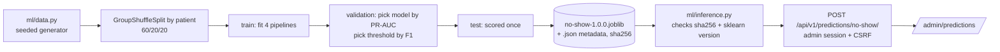

# Week 3: ML pipeline and prediction API (design notes)

## Task

Estimate the probability that a fictional appointment is missed, so staff can decide who gets an extra
reminder. **Non-diagnostic**: it predicts attendance, not health. Data: [DATA_CARD.md](DATA_CARD.md).

## Flow



## Decisions

| Decision | Why |
|---|---|
| **Preprocessing inside the saved Pipeline** (`FunctionTransformer` for derived features → `ColumnTransformer` with median imputer + missing indicator, scaler, one-hot) | One object is trained, saved and served. The API cannot apply different preprocessing from training. |
| **Split by patient**, not by row | A patient's appointments are similar. A row split would put the same person in train and test and overstate accuracy. Tested: no patient appears in two splits. |
| **Every choice on validation, test scored once** | Model choice and the "high" threshold use validation only, so the test numbers are an honest estimate. |
| **Four candidates** | `majority_prior` (floor), `logistic_raw` (baseline), `logistic_engineered` and `hist_gradient_boosting` (improved). The floor shows what "no skill" scores; the oracle shows the best possible. |
| **Improvement came from features, not a fancier algorithm** | Gradient boosting on raw-ish features barely matched logistic regression (first run: PR-AUC 0.3265 vs 0.3263 on validation, and worse on test). Adding five features, each backed by an EDA table, lifted the linear model (validation PR-AUC 0.304 → 0.345) and it beat the tree model too. |
| **No `class_weight`** | Re-weighting distorts probabilities. We show a probability, so it should be calibrated (deciles in the report match observed rates within ~2 points); imbalance is handled by the threshold. |
| **Strict request schema** | Unknown keys are rejected (a typo like `lead_time` can't silently become a default), ranges are checked, `prior_no_shows ≤ prior_appointments`, `distance_km` may be null (imputed like in training). |
| **Model loading is a security boundary** | joblib = pickle = code execution. Only files from `ML_ARTIFACT_DIR` load, only if their SHA-256 matches the metadata and the installed scikit-learn equals the training version. Otherwise `503 model_unavailable` (details go to the server log, not the client). |
| **Versioned URL** `/api/v1/…` + `model_version` in every response | A v2 schema/model can run beside v1; every prediction says which model produced it. |
| **Admin-only, throttled, audited** | Clinic staff use it, members don't. 60/min per user. Each call writes an `admin.prediction` audit row with no inputs and no score. |
| **Pinned dependencies, recorded seed** | `requirements.txt` pins scikit-learn/numpy/pandas/scipy/joblib exactly; seed 42 is in `ml/config.py` and in the metadata. |

## Results (test set, 3,967 appointments, 16.5% no-show)

| Model | ROC-AUC | PR-AUC | Brier |
|---|---|---|---|
| Floor: always the average | 0.500 | 0.165 | 0.138 |
| Baseline: logistic, raw inputs | 0.705 | 0.358 | 0.124 |
| **Served: logistic + engineered features** | **0.712** | **0.371** | **0.123** |
| Gradient boosting + engineered features | 0.707 | 0.356 | 0.124 |
| Oracle ceiling (true generator probability) | 0.717 | 0.372 | 0.123 |

At the threshold 0.236: precision 0.365, recall 0.452, F1 0.404 (TN 2801, FP 513, FN 358, TP 295).

**Reading this honestly:** the served model reaches 99% of the ceiling's ROC-AUC. The remaining error is
mostly irreducible noise in how the data was generated. So "better model" is not the next step;
better *data* (real behavioural signals) would be. Full report: `backend/ml/reports/metrics.md`.

## Error analysis (highlights)

- **Missed no-shows (358)** mostly look like reliable patients: 72% had a reminder, 60% had never missed
  before, median wait 11 days. There's little signal to catch them.
- **False alarms concentrate on the young and the un-reminded:** FPR 29.5% for 18–24 vs 4.6% for 55–64;
  35% without a reminder vs 9% with one. See the bias section of the data card for what that means for use.
- **Calibration** is good: in each predicted-probability decile the observed rate is within ~2.5 points.

## Reproducing

```bash
cd backend
python -m ml.eda      # ml/reports/eda.md
python -m ml.train    # ml/data/*.csv, ml/artifacts/no-show-1.0.0.{joblib,json}, ml/reports/metrics.md
pytest -m slow        # retrains in a fresh process; asserts same data hash, metrics and artifact sha256
```
Byte-identical artifacts are produced by a fresh interpreter. Inside one long-running process that has
already trained other models, pickle bytes can differ (predictions don't); the test runs training in a
subprocess for that reason.
