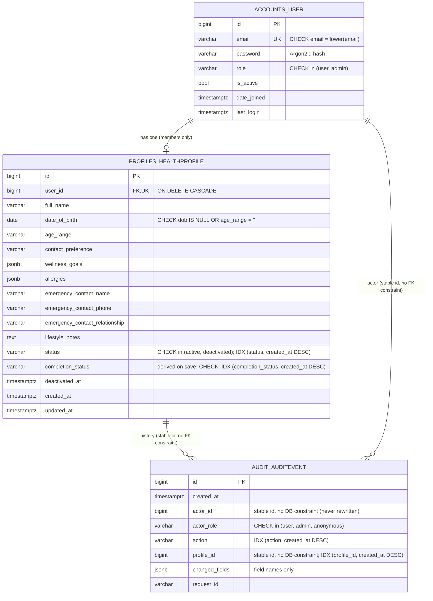
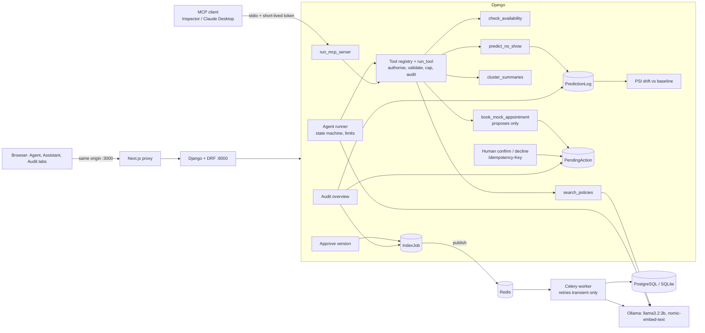

# Architecture and design decisions

## Problem

A small HealthTech product where **members** keep a wellness profile and **administrators** review
profiles. The hard part is not the CRUD; it is that the two roles authenticate in two *different*
ways and must be provably unable to borrow each other's privileges. All data is synthetic and the
app stores wellness preferences, not medical records.

## System overview

```mermaid
flowchart LR
  B[Browser] -- "same origin :3000" --> N[Next.js<br/>pages + /api proxy]
  N -- "/api/* rewrite" --> D[Django + DRF :8000]
  D --> P[(PostgreSQL)]
  subgraph D_internals [Django]
    A1[CookieJWTAuthentication<br/>members] --> V1[/api/profiles/me/]
    A2[AdminSessionAuthentication<br/>admins] --> V2[/api/admin/*]
  end
```

The browser only talks to Next.js. Next forwards `/api/*` to Django, so every cookie is first-party
(no CORS, no `SameSite=None`) and the API is not exposed to arbitrary origins.

## Why this stack

| Choice | Why | Trade-off |
|---|---|---|
| **Django + DRF** | Mature auth primitives (password hashing, sessions, CSRF, migrations, validators). For a security-sensitive assignment I want to *compose audited parts*, not hand-roll them. | Heavier than FastAPI; sync by default. Irrelevant at this scale. |
| **PostgreSQL** | Real constraints (CHECK, partial/composite indexes), `EXPLAIN ANALYZE`, JSONB. SQLite works for a 2-minute local start. | Needs a server; `docker-compose.yml` provided. |
| **SimpleJWT** for members | Standard, maintained JWT implementation with rotation and a blacklist. | JWT is only worth it with the extra care below. |
| **Django sessions** for admins | Server-side revocation, no token the client can hold or forge. Right tool for a small high-privilege group. | Needs a DB/cache lookup per request. |
| **Next.js (App Router, TS)** | Required stack; rewrites give the same-origin proxy for free. | SPA-style client pages (no SSR of private data, on purpose). |
| **drf-spectacular** | OpenAPI/Swagger generated from the code so docs cannot drift. | |
| **Argon2id** | OWASP's preferred password hash. | Slow on purpose; tests swap in a fast hasher. |

## Two auth systems, kept apart on purpose

| | Member | Admin |
|---|---|---|
| Created by | Public `POST /api/auth/signup/` | **Only** `manage.py create_admin` / `seed_demo` |
| Credential after login | JWT access (10 min) + refresh (7 d) in **HttpOnly** cookies | Server-side session id in an **HttpOnly** cookie (30 min idle) |
| DRF authenticator | `CookieJWTAuthentication` | `AdminSessionAuthentication` |
| Permission | `IsStandardUser` (role == user) | `IsAdminRole` (role == admin) |
| Logout | Refresh token blacklisted, **current access token denylisted**, cookies cleared | Session row deleted server-side |
| CSRF | Enforced on unsafe methods | Enforced on unsafe methods |

`DEFAULT_AUTHENTICATION_CLASSES` is **empty**. Every view names its authenticator explicitly, so the
two mechanisms cannot be mixed by accident, and a new view with no authenticator fails closed.

### Why a user token can never reach admin routes (defence in depth)

1. Admin views only run `AdminSessionAuthentication`; they never read the JWT cookie.
2. Even a valid session must belong to a user whose `role` column is `admin` (`IsAdminRole`).
3. Admin accounts have no signup path; the signup serializer has no `role` field.
4. Admin login rejects member credentials and vice-versa (same generic 401, so roles do not leak).
5. The frontend holds **no** auth state; admin pages call `/api/admin/me` on every load. Editing
   `localStorage`/cookies in devtools changes nothing server-side. (Tested in the browser run.)

### Token/session hardening

- Cookies: `HttpOnly`, `Secure` (non-debug), `SameSite=Lax`. The refresh cookie is scoped to
  `/api/auth/user/` so it is not sent with ordinary API calls.
- Refresh tokens rotate and are **single use**; replaying an old one fails (tested).
- JWT claims contain only `user_id`, `jti`, `exp`, `iat`, `token_type`: no password, email or role.
- `alg: none`, tampered-payload, refresh-as-access and `Authorization`-header tokens are all rejected (tested).
- Deactivating a profile sets `user.is_active=False`; because the access cookie is re-checked
  against the DB on each request, an already-issued JWT stops working immediately.
- Login/signup are throttled (10/min, 20/h by default). Login errors are identical for unknown
  email, wrong password, deactivated account and wrong role (no account enumeration).
- Login is CSRF-protected too (prevents login-CSRF); `csrf_protect` is re-applied because DRF
  views are `csrf_exempt` by default.

### Account, profile, credentials: how they relate and what ends them

```
User (account: email, password hash, role, is_active)
 ├── 1:1 HealthProfile        (members only; can be deleted and re-created; the account stays)
 ├── member credentials:      access JWT (10 min) + refresh JWT (7 d, single use), HttpOnly cookies
 │                            stateless; checked against User.is_active and the denylist per request
 └── admin credentials:       session id cookie → django_session row (30 min idle)
AuditEvent → actor id, profile id   (stable ids, never rewritten; API adds *_deleted markers)
```

| Event | Refresh token | Access token (this browser) | Copies of it elsewhere | Admin session | Account / profile |
|---|---|---|---|---|---|
| Member logout | blacklisted | denylisted (`RevokedAccessToken`) | rejected (same jti) | untouched | untouched |
| Member logs out on another device | untouched | untouched | n/a | untouched | untouched |
| Refresh (rotation) | old one blacklisted | new one issued | old access stays valid until it expires (≤ 10 min) | untouched | untouched |
| Access token expires | still valid → silent refresh | rejected (`exp`) | rejected | untouched | untouched |
| Admin deactivates profile | refresh refused | rejected on next request (`is_active`) | rejected | untouched | profile `deactivated`, account inactive |
| Member deletes profile | still valid | still valid | still valid | untouched | profile row gone, account stays, audit keeps the id |
| Admin logout | n/a | n/a | n/a | row deleted; replayed id → 401 | untouched |

Each row has a test in `tests/test_user_auth.py::TestLogoutAndRevocationLifecycle`, `test_profiles.py`
or `test_audit.py`. None of this depends on the frontend: the tests replay copied cookies from a
separate client, which is what a direct API request does.

## Week 3: ML pipeline and prediction API

```
offline (python -m ml.*)                                 online (Django + Next.js)
ml/data → eda → split → preprocess/features → train      Next.js /admin/predictions
        → errors → artifact                                  │ same-origin proxy
                │                                            ▼
                ▼                                        /api/v1/predictions/no-show/  (predictions app)
ml/artifacts/no-show-1.0.0.joblib + .json  ◀── verify ── ml/inference.get_model()  (loaded once per process)
```

| Concern | How |
|---|---|
| Who may call it | `AdminSessionAuthentication` + `IsAdminRole`, the same as every admin route. A member's JWT gets 401 |
| CSRF | Enforced by the session authenticator on POST |
| Abuse | `predictions` throttle scope (60/min per admin); request body capped at 4 KB (413) |
| Input | Strict serializer generated from `ml.config.FEATURE_SCHEMA`, the same schema stored in the model metadata and in `frontend/lib/noShowSchema.json`. Tests compare all three |
| Audit | `admin.prediction_made` with the model version in the nullable `detail` column, never the input values. The column was added without a table rebuild, so the append-only triggers survive |
| Failure | `ModelUnavailable` → `503 model_unavailable`; the reason is logged server-side only |
| Versioning | `/api/v1/` is the input/output contract; `model_version` in each response names the model |

Design notes per step: [WEEK3.md](WEEK3.md).

## Database



Also present (from libraries): `django_session` (admin sessions) and
`token_blacklist_*` (revoked/rotated refresh tokens).

| Index / constraint | Exists because |
|---|---|
| `UNIQUE(email)` + `CHECK(email = lower(email))` | One account per address, case-insensitively, enforced by the DB even if app code is bypassed (tested with `bulk_create`). Also serves the login lookup. |
| `hp_status_created_idx (status, created_at DESC)` | Admin list "filter by status, newest first, paginate". Equality column first, sort column second: no sort step. Measured 2.9 ms vs 14.1 ms without it (see `docs/explain-postgres.md`). |
| `hp_full_name_idx (full_name)` | Admin list sorted by name. |
| `UNIQUE(user_id)` | Exactly one profile per member. |
| `CHECK(dob IS NULL OR age_range = '')` | Prevents contradictory age data. |
| `CHECK(role IN ...)`, `CHECK(status IN ...)` | Bad enum values cannot be stored. |
| `hp_completion_created_idx (completion_status, created_at DESC)` | Week 2: admin "incomplete profiles, newest first" follow-up list. 5.5 ms → 0.20 ms at 20k rows. |
| `audit_profile_created_idx (profile_id, created_at DESC)` | Week 2: "history of this profile" on the admin detail page, including after the profile is deleted. 5.8 ms → 0.06 ms at 60k events (`benchmark_admin_queries`). Replaces Django's default FK index (`db_index=False`). |
| Triggers `audit_event_no_change` / `_no_truncate` (PostgreSQL), `audit_event_no_update` / `_no_delete` (SQLite) | The audit table is append-only **in the database**: every UPDATE, DELETE (and TRUNCATE on PostgreSQL) is rejected, whatever code path issues it. Migration `audit/0004`. |
| `audit_action_created_idx (action, created_at DESC)` | Week 2: audit list filtered by action ("all deactivations"), newest first. |

### Week 2 design notes

- **Completion is stored, not computed per request.** The rules live in one pure module
  (`profiles/completion.py`); `HealthProfile.save()` writes the result to `completion_status` (and adds it
  to `update_fields`, so partial saves can't leave it stale). Storing it lets admins filter and the DB
  index it. `bulk_create` skips `save()`, so the seeder computes it explicitly; migration `0002` backfills
  existing rows. The detailed `percent` / `missing_sections` are computed on read from the same rules.
- **Audit events are append-only and value-free.** `AuditEvent.save()` refuses updates and `delete()`
  refuses deletes; the API is GET-only. Only field *names* are stored, so the log can't leak a phone
  number, note or password. Each event carries the request's `X-Request-ID` (set by
  `config/middleware.py`) so a log line, an audit row and a bug report can be linked.
- **The edit and its audit row commit together** (`transaction.atomic`): there is never an edit without
  a record, or a record of an edit that rolled back. No-op saves and rejected edits record nothing.
- **Viewing is audited too** (`admin.profile_viewed`): reading someone's data is an action. List views
  aren't, to avoid one row per page of results.

Search (`icontains` on name/email) cannot use a B-tree index; at larger scale use `pg_trgm` GIN.
I did not add one: it would be an unmeasured index for a 6-row demo.

## Week 5: the agent tool layer (Step 6)

The `agent` app holds a small typed tool registry (`agent/registry.py`) and four read tools (`agent/read_tools.py`):
`search_policies`, `check_availability`, `predict_no_show` and `cluster_summaries`. The Step 8 agent and the
Step 9 MCP server read the same tool definitions.

```
server builds ToolContext(user, request_id, clock, embedder, llm) from the authenticated request
        │
run_tool(name, args, ctx) ── authorise (ctx.user's role, every call) ── validate args (JSON schema)
        │                                                                   │
        └── handler(args, ctx) ── deadline ── validate output ── size cap ── audit (tool:outcome)
```

- **Identity never comes from tool arguments.** No schema has a user, role or permission field, every input
  object forbids extra keys, and handlers take only `(args, ctx)`. A test walks every schema.
- **Failures are typed results** (`invalid_input`, `not_allowed`, `unavailable`, `timeout`, `output_too_large`,
  `refused`) with fixed messages, so the Step 8 agent can recover without seeing internal details.
- **Deadlines:** a slow call is ended by its own client timeout; a result that arrives after the tool's
  deadline is discarded. This isn't pre-emptive, because Python can't safely kill a thread that holds a database connection.
- There is no endpoint in Step 6. The Step 8 agent endpoint will be the only way in.
- **MCP (Step 9):** the same 4 read tools over stdio, through `run_tool`, for local MCP clients; see [MCP.md](MCP.md).
- **Writes (Step 7) need a human.** `book_mock_appointment` only stores a pending action. A human confirms through
  `/api/v1/agent/actions/<id>/confirm/`, which is not a tool, with an `Idempotency-Key`. Authorisation and the slot
  are re-checked at confirmation, and a unique constraint (clinician, date, time) decides races.

## Week 5: the whole system (A11)



Key decisions:
- **The model only proposes.** The server validates and authorises every call, renders tool results itself, and lets model text through only as a verified policy answer or a short clarify or decline.
- **One tool layer for the agent and MCP.** There's a single place where security is enforced.
- **Writes need a human:** a pending action plus a confirm endpoint (which isn't a tool), with an idempotency key.
- **Background indexing on Celery + Redis.** States live in our own table (for the audit page), and only transient failures are retried.
- **Monitoring is PSI on the prediction distribution** against a validation-split baseline. Logs keep no inputs.

Contracts: [TOOLS.md](TOOLS.md) · threats: [THREATS.md](THREATS.md) · MCP: [MCP.md](MCP.md).

## Known limitations (be upfront about these in the demo)

- **Audit log growth:** no retention policy yet (needs one: e.g. archive after N months). Because the
  table is append-only in the database, archiving will need a deliberate, privileged procedure.
- **Append-only has limits:** the triggers stop the application and anyone using its DB role, but a
  database superuser can drop them. Production should give the app role only INSERT/SELECT on the
  audit table and ship events to separate storage. Not implemented here.
- **After a refresh**, the previous access token stays valid until it expires (≤ 10 min). Logout and
  deactivation revoke immediately; rotation does not.
- **Throttle counters are per-process** (`LocMemCache`). Use Redis in production, and configure the
  client-IP header correctly behind a proxy.
- No email verification, password reset, MFA or account lockout (only throttling).
- Admin list search is `icontains`, which scans (~20 ms at 20k rows, `docs/explain-postgres.md`); a
  `pg_trgm` index is the next step.
- `docker-compose.yml` is provided but was not run (no Docker on the development machine). CI runs
  the full suite on PostgreSQL 16 and SQLite (`.github/workflows/ci.yml`); it was also run locally
  on PostgreSQL 14.21.
- Wellness data is still personal data; real use would need encryption at rest, audit logging and
  legal review (GDPR/HIPAA as applicable). Out of scope for this prototype.
